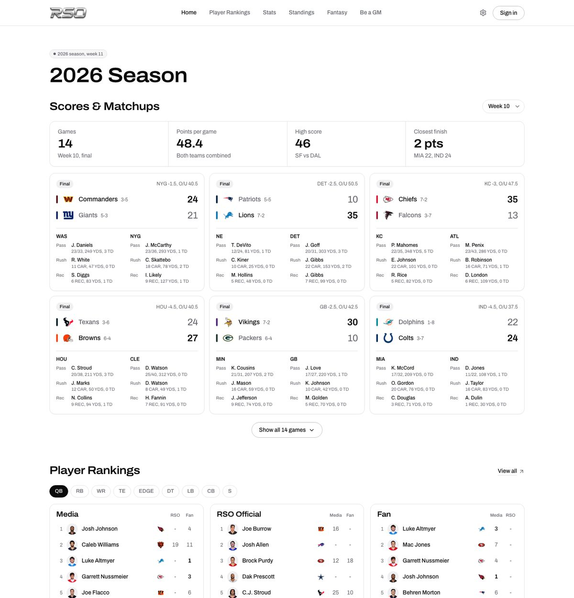
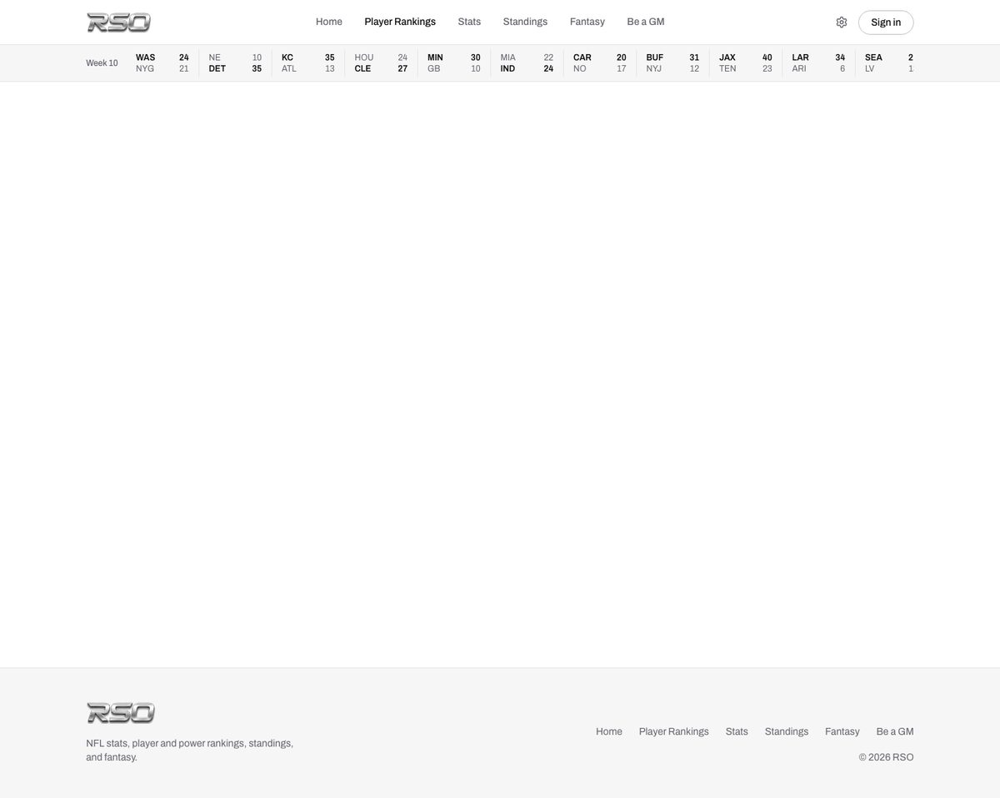
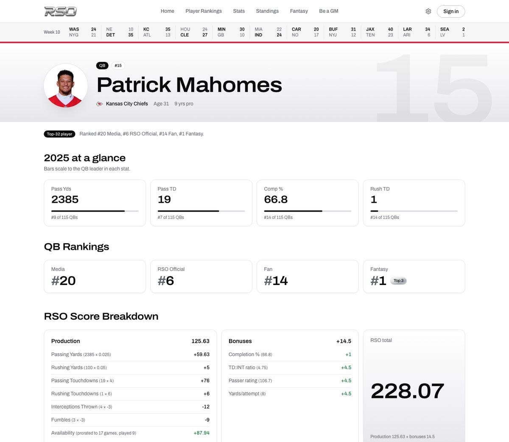

# RSO — The Real Sports Opinion

An NFL stats, rankings and fantasy site built on **live nflverse data**, with its own
transparent player-rating engine. Three opinions sit side by side on every ranking:
an editor's **Media** board, the data-driven **RSO Official** score, and the
aggregated **Fan** vote.

**Stack:** Next.js 16 (App Router) · TypeScript · Tailwind CSS v4 · Supabase · Vitest · Python/Polars for the data pipeline



---

## What it does

| Page | What's there |
|---|---|
| **Home** (`/`) | Week summary tiles, scoreboard with per-game leaders, embedded rankings, stat leaders, standings, the league feed and fantasy |
| **Player Rankings** (`/rankings`) | Media / RSO Official / Fan boards per position, top three as feature cards, cross-source rank comparison |
| **Stats** (`/stats`) | Every tracked stat for every position, sortable and searchable, with a sticky player column |
| **Standings** (`/standings`) | League / conference / division scopes, win-percentage bars, plus RSO and Media power rankings with movement arrows |
| **Fantasy** (`/fantasy`) | Real PPR scoring by week or season to date, position filters, and a waiver watch comparing recent form to season average |
| **Game** (`/game/[id]`) | Scoreboard, box score, and an animated field with play-by-play |
| **Team / Player** (`/team/[id]`, `/player/[id]`) | Rosters, team splits, season-at-a-glance bars, career stats, and the full RSO score breakdown |



## The RSO scoring engine

`src/lib/rsoScoring.ts` is a pure, data-driven rating system — the core of the project.

- **Production points** per position (e.g. a safety earns 8 per interception, 0.75 per solo tackle).
- **Tiered bonuses** where only the highest matching tier fires, so a 72%-completion
  quarterback gets the top bonus rather than the sum of every tier below it.
- Every score comes with a **breakdown** — which stat contributed what, and which
  bonuses fired — rendered on each player page.
- Unit-tested against hand-checked players (`src/lib/rsoScoring.test.ts`).

The same engine ranks players on `/rankings` and feeds the team power rankings
on `/standings`.

## Live data

All NFL data comes from [nflverse](https://github.com/nflverse) via
[nflreadpy](https://github.com/nflverse/nflreadpy). One Python script fetches and
reshapes it into the exact TypeScript types the app consumes:

```bash
python3 scripts/fetch_nfl_data.py   # writes src/data/real/*.json
```

It produces teams and records, rosters with real injury designations, season and
career stats, the full schedule (played and upcoming), weekly box scores, weekly
PPR fantasy points, OverTheCap contract values, and a generated league feed. The
feed is derived from the data itself — top performances, injury designations,
upcoming matchups — not hand-written copy.

Every page reads through `src/data/api.ts`, so swapping the data source is a
one-folder change.

A [GitHub Action](.github/workflows/refresh-data.yml) reruns the fetch every
Tuesday morning, verifies the site still builds against the new data, and
commits it only when something actually changed. The season is detected from
the calendar, so it rolls over on its own each September.



## Running it

```bash
npm install
npm run dev          # http://localhost:3000
```

Other scripts:

```bash
npm run build        # production build
npm start            # serve the production build
npm test             # Vitest unit tests
npm run lint         # ESLint
```

### Accounts (optional)

The site runs fully on the public NFL data with no configuration. Accounts, fan
voting and the admin editor need a Supabase project:

1. Copy `.env.local.example` to `.env.local` and fill in your project URL and keys.
2. Run `supabase/schema.sql` in the Supabase SQL editor.

Full walkthrough: [docs/SUPABASE_SETUP.md](docs/SUPABASE_SETUP.md). Without it,
auth surfaces explain what's missing and everything else works.

## Project structure

```
src/
  app/            routes (App Router) — one folder per page
  components/     reusable UI: RankingTable, StatLeaderCard, PositionTabs, …
  data/           typed data layer; api.ts is the only thing pages call
    real/         JSON written by the fetch script
  lib/            RSO scoring engine, team power model, stat formatting
  store/          Zustand UI state
scripts/          Python data pipeline
supabase/         database schema with row-level security
docs/             product spec, Supabase setup, screenshots
```

Design decisions and tokens live in [DESIGN.md](DESIGN.md); product context in
[PRODUCT.md](PRODUCT.md).

## License

[MIT](LICENSE). NFL data belongs to its respective owners and is used here via
nflverse for a non-commercial portfolio project.
